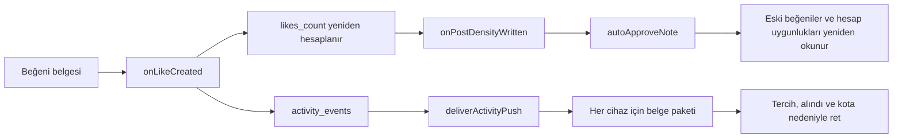

# Maliyet zincirleri ve eşzamanlılık — derin inceleme, 23 Ekim 2026

> **Güncel durum:** Bu dosya uygulama öncesi başlangıç denetimidir; aşağıdaki eski davranışlar güncel kodun durumu diye okunmamalıdır. Yerelde uygulanan karşılıklar, ölçülen sonuçlar, kapsam sınırları ve geçiş sırası [uygulama raporundadır](COST_OPTIMIZATION_IMPLEMENTATION_2026-10-23.md). Canlıya dağıtım yapılmadı.

Kaynak: yerel `60afbca` + mevcut çalışma ağacı, `codex/fix-anonymous-location-audit`. Bu inceleme önceki 16 adayın olay zincirlerini, paralel çalışmasını, başarısızlık ve ret yollarını derinleştirir. Aşağıdaki 13 bulgu **uygulama adayı veya sözleşme uyumsuzluğudur**; bu turda iOS/Functions/admin üretim kaynakları değiştirilmedi. Önceden uygulanan harita paketi korunur.

Önceki rapor: [Harita dışı optimizasyon fırsatları](COST_OPTIMIZATION_OPPORTUNITIES_2026-10-23.md). Harita uygulaması ve ayrı regresyon kanıtı: [Harita derin incelemesi](MAP_COST_DEEP_AUDIT_2026-10-23.md).

## En önemli sonuç

Yalnızca callable sayısını azaltmak yeterli değil. Bir beğeni, sayaç güncellemesi üzerinden bütün eski beğenilerin tekrar taranmasına; bir push denemesi, gönderilmeyeceği belli olsa bile cihaz başına geniş bir belge paketinin okunmasına yol açabiliyor. Telefonda tekrarları engellemenin yanında sunucuda ucuz ret koşulları önce çözülmeli, geçmişi yeniden tarayan işler ayrı ele alınmalı. Ayrıca D13'te, yayın anındaki GIF doğrulamasının altı saatlik cache kullanması mevcut yeniden okuma sözleşmesine uymuyor; tasarruftan önce bu ayrım düzeltilmeli.

Bu diyagram işlem akışını gösterir; bütün zincirin uçtan uca fatura ölçümü değildir. Aşağıdaki deneyler gerçek derlenmiş girişleri sahte veri erişimiyle ayrı ayrı çalıştırır.

## Çalıştırılarak doğrulanan bulgular

### D13 — Yayındaki GIF doğrulaması altı saatlik eski sonucu kabul edebiliyor

`functions/src/giphy.ts:36`, `:108–126`, `functions/src/posts.ts:87`; ilgili mevcut test: `functions/test/giphy.test.mjs`.

Proje sözleşmesi `createPost` sırasında GIPHY id/rating/boyutunun sağlayıcıdan yeniden okunmasını istiyor. Gerçek varsayılan `fetch` yolu ise `gifCache` sonucunu altı saate kadar kullanıyor. Kontrollü deneyde ilk sağlayıcı cevabı `g` idi; ikinci doğrulama öncesi sahte sağlayıcı `r` verecek şekilde değiştirildi. Aynı GIF'in iki yayın doğrulaması **yalnız bir sağlayıcı okumasıyla** başarılı oldu. Cache'i kullanmayan enjekte fetch kontrolü aynı `r` cevabını yeniden okuyup `invalid-argument` ile reddetti. Gerçek post oluşturulmadı; gerçek `resolveGifLayers` yayın doğrulama fonksiyonu çalıştırıldı.

Burada istemci rating'i güvenilir kabul edilmiyor; sorun daha önce kabul edilmiş sağlayıcı bilgisinin yeniden kullanılması. `fetcher === fetch` koşulu nedeniyle enjekte HTTP bağımlılığıyla yazılmış mevcut unit senaryoları cache kullanan varsayılan yolu temsil etmiyor. Bu, testler yeşilken davranış farkının saklanmasına neden olabilir.

**Düzeltme yönü:** Arama/trend sonucu cache'i korunabilir. Yeni yayın kararında önceden tamamlanmış altı saatlik doğrulama sonucu kullanılmamalı; her yeni yayın sağlayıcıdan yeniden okunmalı. Aynı mutation'ın tamamlanmış idempotent replay'i ayrı kalır. Varsayılan global fetch yolunu da taklit eden regresyon, art arda yayınlarda rating değişimi/404/timeout/boyut değişimi ve yayın öncesi fail-closed davranışı kapsamalı. GIPHY'nin canlı içeriğinin sonradan değişmesi tümüyle çözülmüş sayılmaz; bu bulgu yayın anındaki açık sözleşmeyle ilgilidir. **Henüz düzeltilmedi.**

### D1 — Yeni hesapların beğenileri aynı geçmişi tekrar okutuyor

`functions/src/triggers.ts:52`, `functions/src/noteDensity.ts:85`, `functions/src/noteAutomation.ts:53`.

`push_state=none` bir konum notunun `likes_count` alanı arttığında `autoApproveNote` çalışıyor. Ham sayı eşiği geçtiyse beğeniler 200'lük sayfalarla taranıyor; her tekil beğenen için profil ve silme işi okunuyor. En az 24 saatlik yeterli hesap bulunamazsa ilerleme saklanmıyor. Sonraki artış aynı geçmişi tekrar tarıyor. Bu durum ilk gün kullanıcılarının ağırlıkta olduğu açılış döneminde özellikle anlamlıdır; gerçek trafik sıklığı ölçülmedi.

- 20 yeni hesap: **62** mantıksal belge okuması, onay yok.
- 50 yeni hesap: **152** okuma, onay yok.
- 199 yeni hesap: **599** okuma, onay yok.
- Ayrı deneyde beğeni sayısı 3→199 ilerletilerek 197 kontrol çalıştırıldı: toplam **60.085** okuma, onay/yazma yok. Bu, her artışın ayrı işlendiği kontrollü senaryodur; gerçek tetikleyici zamanlamasının aynı diziyi izleyeceği varsayılmaz.

**Öneri:** Yeni reaksiyon/üyelik nesli üzerinden sınırlı uygunluk yan kaydı ve hesap yaşının dolacağı zaman için planlama. Son onaydan önce seçilen yeterli sayıda beğeninin halen varlığı, profiller ve silme durumları aynı transaction içinde taze doğrulanır. Beğeniyi kaldırıp ekleme, tekrar/sırasız olay, silinen hesap ve geç gelen kayıtlar kapsanmalı. UUID sırasındaki tek imleç yeni eklenen önceki anahtarları kaçırabilir. Eski hesap durumu cache'i onay yetkisi vermez. Sabit “beğeni başına üç okuma” henüz kanıtlanmış değildir.

### D2 — Push kapalı, daha önce denenmiş veya kota doluyken de geniş okuma yapılıyor

`functions/src/push.ts:69`, `:79`, `:87`, `:94`, `:102`; en fazla 10 cihaz: `functions/src/pushPolicy.ts:3`.

Gönderili bir etkileşimde ilk etkinlik + cihaz sorgusuna ek, cihaz başına önce 11 belge, sonra tercih okunuyor. `D` cihaz için kontrollü yolda toplam `1 + 13D` mantıksal belge okuması var. Üç farklı 10 cihaz senaryosunda **131 okuma, sıfır gönderim, sıfır yazma** doğrulandı: bildirim tercihi kapalı, teslim alındısı zaten var, günlük kota başka etkinliklerle dolu.

**İlk güvenli adım:** Her cihaz transaction'ında alındı/tercih/kotayı önce oku; ret varsa kalan hesap/engel/gönderi/hedef paketine girme. İzin verilecekse tüm güncel kontroller aynı transaction'da tamamlanır, sonra claim yazılır. Üç ön belgeyle ret, bu belirli 10 cihaz örneğinde teorik olarak 41 mantıksal okumaya iner; **değişiklik uygulanmadı ve sonrası ölçülmedi**. İzin verilen yolda belge sayısı artmamalı; ek RPC/gecikme ölçülmeli.

Kota kararı mevcut `pushQuotaDecision` ile verilir. Sadece `count >= limit` kontrolü yanlış olur: aynı etkinliğin diğer cihazları `activity_ids` nedeniyle halen gönderilebilir. Claim-before-send ve dış servis sınırındaki mevcut en fazla bir deneme sözleşmesi korunur. Cihazlar arasında eski yetki sonucunu yeniden kullanma bu ilk adımın parçası değildir.

### D3 — GIPHY soğuk cache'te eşzamanlı aynı aramalar birleşmiyor

`functions/src/giphy.ts:149`, `:160`, `:164`, `:174`.

Sunucu sonuç cache'i zaten var; cache dolmadan gelen çağrılar için ortak devam eden iş yok. Sekiz ayrı sahte kullanıcıdan aynı sorgu/dil/ofset ile sekiz eşzamanlı arama: **8 dış çağrı, 24 belge okuması, 8 kota yazması**. Cache dolduktan sonraki arama: **0 yeni dış çağrı**, yine **3 okuma + 1 kota yazması**.

**Öneri:** Her çağrının kendi güncel hesap/kota kontrolünden sonra, normalize sorgu/dil/ofset anahtarında aynı süreçteki devam eden dış isteği paylaş. Anahtar sayısı sınırlı olsun; başarısızlık ve iptalde `finally` ile temizlensin. Farklı sorguların sonuçları karışmasın. Bu, iOS'ta tekrar aramayı önleyen O6'dan ayrı bir kazançtır; cihaz katmanı callable/Firestore işini de azaltabilir. Sunucu paylaşımı bütün örnekler için tek çağrı garantisi vermez. Cloud Run aynı örnekte eşzamanlı istek işleyebilir; canlı concurrency değeri bu incelemede okunmadı. [Cloud Run eşzamanlılık belgesi](https://docs.cloud.google.com/run/docs/about-concurrency).

### D4 — Yayın alındısı yolunda hesap çiti iki kez okunuyor

`LociAR/Data/PostRepository.swift:95`, `functions/src/publicContent.ts:82`, `:104`.

İstemci publish/retry öncesinde `own_receipt` ister. Dış dispatcher iki hesap belgesi okur; iç `readOwnReceipt` transaction'ı aynı iki belgeyi ve postu tekrar okur. Henüz yayınlanmamış örnekte **5 okuma** doğrulandı.

**Öneri:** `requireCaller` sonrasında `own_receipt` modunu genel ön kontrolden önce ayır; iç transaction'daki güncel hesap + post sahipliği kontrolü aynen kalsın. Hedef bu yol için **5→3** mantıksal okuma; henüz uygulanmadı. İstemci alındısını tamamen kaldırma: kaybolan yayın cevabında silinmiş taslak dosyalarına geri dönmeden sonucu kurtarıyor. `createPost` da pahalı hazırlıktan önce sunucu idempotency kontrolünü zaten yapıyor.

### D5 — Kampanya izni kapalı kullanıcıda atamalar yine açılıyor

`functions/src/campaigns.ts:19`, `:36`; yakın AR içeriğinden bu yola giriliyor.

`ownCampaignOffers` önce aktif hesabı ve en fazla 50 atamayı okuyor. Her atamada kampanya, hedef ve aynı tercih belgesi okunup `promotions=false` sonrasında ret veriliyor. 10 geçerli atamalı, promosyon izni kapalı örnekte **42 okuma, sıfır teklif** doğrulandı.

**Öneri:** Aynı transaction'da tercihi atama sorgusundan önce kontrol et. İzin açıksa tercih, çağıran hesap ve sorgudan gelen hedef belgelerini o transaction içinde paylaş; marka/yazar/engel/son kullanma kontrolleri taze kalsın. O9'daki coğrafi kampanya dizini probleminden ayrı bir erken ret iyileştirmesidir.

### D10 — Bellek kotasının kapasite temizliği geçerli pencereleri de siliyor

`functions/src/memoryLimits.ts:18–30`.

Aktif anahtar sayısı kapasiteye ulaşır ve eski pencere temizliği yer açamazsa `hits.clear()` bütün aktif sayaçları sıfırlıyor. Gerçek yardımcı sınıfı kapasite=2 ile çalıştırıldı: aynı pencerede kotası dolan anahtar, kapasite temizliği sonrası yeniden kabul edildi. Varsayılan kapasite 20.000; üretimde bu koşulun yaşandığına dair ölçüm yok.

**Öneri:** Geçerli pencereleri topluca sıfırlamayan, yeni anahtar baskısında davranışı açık olan sınırlı kapasite politikası. Pahalı yolların toplam gider sınırı ayrıca korunmalı; her harita hareketine Firestore kota yazması eklemek çözüm sayılmaz. Süreç belleği yeniden başlatma/ölçekleme ile zaten yenilenebildiğinden bu yardımcı proje çapında kesin harcama tavanı değildir.

## Kaynakta doğrulanan, çalışma zamanı maliyeti henüz ölçülmeyen adaylar

### D6 — Avatar cache'i byte sınırlı değil ve aynı indirmeyi paylaşmıyor

`LociAR/Data/AvatarStore.swift:66–82`, `LociAR/DesignSystem/LociTheme.swift:272`.

Cache yalnızca öğe sayısına bakıyor. Eklemeden önce `count > 100` kontrolü nedeniyle 101 öğe tutabilir; her biri 3 MiB altında olduğundan teorik kod üst sınırı 303 MiB altı **sıkıştırılmış veri**dir. Bu fiziksel bellek ölçümü veya tipik kullanım tahmini değildir; çözülmüş görsel belleği ayrıca vardır. Sınır geçildiğinde bütün cache'in silinmesi tekrar indirmeyi artırabilir. Actor içindeki `await` noktaları aynı cache miss'i için birden fazla byte indirmesine izin verir. Her View ayrıca `UIImage(data:)` çağırır.

**Öneri:** Byte bütçeli LRU, bellek uyarısında küçültme, hesap/nesne yolu/generation ile sınırlı devam eden indirme paylaşımı ve görüntüleme boyutuna uygun çözme. Mevcut yükleme zaten en fazla 1024 px'e küçültür; “hiç küçültme yok” iddiası doğru olmaz. Metadata ile güncel erişim denetimi cache hit'te de korunmalı; salt 10 dakika bekletmek silinen avatarın gösterilmesine yol açabilir. Yeni hesap/generation ve geç gelen indirme sonuçları test edilmeli.

### D7 — Hesap silme aşaması kaydediliyor ama tekrar o aşamadan başlamıyor

`functions/src/accountDeletion.ts:54`, `:135`, `:210`, `:217`.

İş `stage=storage/auth` kaydetse de yeni deneme her zaman `firestore` aşamasını kurup baştan temizliyor. Geç bir Storage/Auth hatası, önceki tamamlanmış koleksiyon sorgularını tekrar ettiriyor; boş sorguların da asgari ücretli okuması olabilir. [Firestore ücretlendirmesi](https://firebase.google.com/docs/firestore/pricing).

**Öneri:** Lease/fencing ile korunan kalıcı aşama tamamlanması ve sınırlı ilerleme. Crash sonrası aynı aşama güvenle tekrar edebilmeli. Auth kapatılmasından sonraki geç upload temizliği ve nihai doğrulama atlanamaz. Mevcut hesap silme kuyruğunda backoff zaten var; sorun sabit beş dakika tekrar değil, tamamlanan işi tekrar yapması.

### D8 — Aynı spot, toplu silmede tekrar tekrar yeniden sayılıyor

`functions/src/accountDeletion.ts:117–131`, `functions/src/noteDensity.ts:78`, `functions/src/denseSpots.ts:118`.

Bir batch'teki her silinen post için aynı `spot_id` yeniden sayılabiliyor; üyelik temizliği ve silme tetikleyicisi de aynı onarımı çağırabilir. `repairSpotCount`, `count()` aggregate kullanmıyor; spotun kaynak post belgelerini getirip filtreliyor.

**Öneri:** Batch içinde üyelikleri tamamlayıp tekil spot kimliklerini bir kez onar. Bağımsız tetikleyiciler arası birleştirme gerekirse sürümlü dirty iş kaydıyla yeni değişikliği kaybetmeyen protokol tasarla. Hard delete yakınsaması, eski üyesiz postlar ve olay tekrarları kanıtlanmadan onarımı kaldırma veya kör sayaç azaltma yapma. Sık silme/toplu seed geri alma varsa önem kazanır; trafik ölçülmedi.

### D9 — Avatar silme hatası sabit aralıkla süresiz tekrar ediyor

`functions/src/avatar.ts:200–214`, `functions/src/cleanup.ts:218`.

Storage silmesi sürekli başarısızsa `attempts` artıyor ama `next_at` hep beş dakika sonrasına gidiyor. Beş dakikalık worker kesintisiz çalışırsa, tek arızalı iş için günde yaklaşık 288 tekrar fırsatı oluşur; gerçek çalışma sayısı/kota/gece işi bununla aynı varsayılmaz. Seçili avatarın silinmesini önleyen kontrol mevcut.

**Öneri:** Silme yükümlülüğünü ve kuyruk kaydını koruyan sınırlı üstel backoff + rastgele pay, kalıcı hata alarmı ve onarım yolu. Bütün cron periyotlarını uzatma. Hesap ve anchor retry yolları zaten backoff içeriyor; bu bulgu avatar yoluna özgü.

### D11 — Yerel yayın kuyruğu 15 saniyede bir tüm uygun kayıtları getiriyor

`LociAR/AppCore/RootView.swift:99`, `LociAR/Data/SyncQueueProcessor.swift:34–53`.

SwiftData sorgusu sahip filtresi/fetch limiti olmadan due kayıtları getiriyor; sahipsiz eski kayıtlar decode ediliyor, sonra hesap filtresi uygulanıp ilk 10 işleniyor. `force` yolu dead letter kayıtları dahil bütün kuyruğu getiriyor. Boş kuyruğun kendi başına Firestore çağrısı yaptığı söylenemez; temel etki telefon CPU/yerel I/O/pildir.

**Öneri:** Sahipsiz eski kayıtları ayrı göçle düzelt; sahip + due koşulu ve 10'luk fetch limiti kullan. Yeni iş/bağlantı/dönüş olaylarıyla uyan, sonraki iş zamanına göre bekle. Manuel force yalnızca ilgili hesabı ve mevcut güvenli retry davranışını kapsasın. Hesaplar arası kayıt açma/işleme, sıralama ve iptal testleri gerekir.

### D12 — Yayın kotası reddi bazı pahalı hazırlıklardan sonra geliyor

`functions/src/posts.ts:83–93`, `:147–163`, `functions/src/anchors.ts:118`, `functions/src/postAdmission.ts:35`.

Yeni yayın için Storage/GIPHY/yer hazırlığı, ana transaction'da korumalı bölge taraması ve 27 yoğunluk kilidi okuması, saat/gün kotası reddinden önce gelebiliyor. `admitPost` kendi yakın sayımından önce kotayı zaten kontrol ediyor; eksik olan daha dıştaki işlerin sırası.

**Öneri:** Ucuz kota ret planını atomik kabul transaction'ında mümkün olduğunca öne al; tüm okumalar yazmalardan önce tamamlanmalı. Dış servis ön kontrolü ayrı ek okumalar gerektirecekse izin verilen yola getirdiği giderle birlikte ölç. Bölge/yaş/moderasyon/ankraj kuralları, son taze kota kontrolü ve sınır yarışlarını önleyen 27 kilit korunmalı. Kota tüketimini hazırlık bitmeden yazmak doğru olmaz. Bu madde trafik koşuluna bağlıdır; toplam tasarrufu henüz ölçülmedi.

## Önceki önerilerde düzeltilen varsayımlar

- Plan §13'teki eski “önbellekli hesap durumu” ve sabit üç okuma vaadi kaldırılmalı; D1 protokolünün onay anındaki taze kontrolü şart.
- Plan §19'daki cihazlar arası geniş yetki paylaşımı ve kesin 14→6 iddiası yerine D2'nin retleri önce çözmesi seçilmeli. Yeni bir ortak atomik claim tasarlanırsa ayrıca doğrulanmalı.
- Plan §26'da sunucu GIF arama cache hit'i Firestore'u sıfırlamaz; D3 bunun çalışan kanıtıdır. Cihaz sonucu yeniden kullanıp çağrı göndermediğinde sunucu işi önlenir. Yayında taze sağlayıcı okumasının zaten yapıldığı yönündeki eski varsayım da D13 ile düzeltildi; gerçek yol altı saatlik doğrulama cache'i kullanabiliyor.
- Plan §37'de metadata kontrolünü 10 dakikaya çıkarmak varsayılan tasarruf yöntemi olmamalı; D6 erişim iptalini korur.
- Plan §16'da her işe `hasWork()` eklemek kendiliğinden kazanç değildir: zaten due sorgusu yapan işe ikinci sorgu ekleyebilir. Kuyruk bazında ölçülmeli.
- İlk auth dinleyicisi tekrarı önceki pakette azaltıldı. Arka plandan gerçek dönüşte `RootView.swift:82` → `bootstrap` → `currentUser` → `ensureProfile` halen çalışıyor. `profile.ts:45–51` mevcut hesapta özel last-seen ve erişim belgelerini yazıyor; public profile'ı her dönüşte yeniden yazdığı iddiası doğru olmaz. Okuma ağırlıklı oturum yenileme ile seyrek heartbeat ayrı tasarlanmalı; kimlik bağlama/terms/luid ve sunucu hesap çitleri korunmalı.
- `posts` içindeki beş büyük JSON alanı `firestore.indexes.json:415–438` altında zaten indeks dışı. Bunları yeniden yapılacak iş sayma. `map_group_sessions.post_ids` hesap silmede `array-contains` ile sorgulanıyor; bütün array indekslerini körlemesine kapatma.
- Push token coordinator aynı kullanıcı/token/locale kaydını 24 saat içinde zaten atlayabiliyor; her foreground token yazması iddiası doğru olmaz.
- Sunucu yayın replay kontrolü pahalı hazırlıktan önce zaten var. Yeni idempotency altyapısı gerekmiyor; D4 çift hesap okumasını hedefliyor.

## Doğrulama ve sınırlar

Node 22 ile güncel backend `npm --prefix functions run build` derlendi. Gerçek derlenmiş `readPublicContent.run`, `searchGifs.run`, `resolveGifLayers`, `autoApproveNote`, `ownCampaignOffers`, `deliverActivityPush` ve `WindowLimiter` çalıştırıldı. Firestore I/O ve dış HTTP/FCM gönderimi sahte bağımlılıklarla değiştirildi; gerçek Firebase/GIPHY/FCM çağrısı yapılmadı. Beklenmeyen belge türü ve beklenen sonuç/okuma sayısı için assertion var.

| Senaryo | Kontrollü sonuç |
|---|---|
| `own_receipt` | 5 okuma, alındı yok |
| `giphy_cold_concurrency` | 8 eşzamanlı aynı arama → 8 dış çağrı, 24 okuma, 8 kota yazması |
| `giphy_warm_cache` | 0 yeni dış çağrı, 3 okuma, 1 kota yazması |
| `giphy_publish_rating_changed_cached` | İki yayın doğrulaması, bir sağlayıcı okuması; rating g→r değişse de ikincisi kabul edildi |
| `giphy_publish_rating_changed_fresh_control` | Aynı r cevabını taze okuyunca invalid-argument ile ret |
| `campaign_opt_out` | 10 atama → 42 okuma, 0 teklif |
| `young_likes_20` | 62 okuma, onay/yazma yok |
| `young_likes_50` | 152 okuma, onay/yazma yok |
| `young_likes_199` | 599 okuma, onay/yazma yok |
| `young_likes_sequential_growth` | 197 kontrol → 60.085 okuma, 0 yazma |
| `push_disabled` | 10 cihaz → 131 okuma, 0 gönderim/yazma |
| `push_receipt_exists` | 10 cihaz → 131 okuma, 0 gönderim/yazma |
| `push_quota_full` | 10 cihaz → 131 okuma, 0 gönderim/yazma |
| `memory_limit_capacity` | Kapasite temizliği sonrası aynı pencerede tekrar izin |

**14 tanısal senaryonun bütün assertion'ları geçti.** Bu, hatalı davranışların da yeniden üretildiğini gösterir; uygulamanın bu sorunlardan arındığı anlamına gelmez. Artefaktlar: `build/cost-deep-chain-20261023/probe.mjs`, `probe-results.jsonl`, `probe-errors.log` (boş), `backend-build.log`; ilk script kopyası `/tmp/lociar-cost-deep-chain-20261023.mjs`. Bu dizinler geçicidir; sonuçlar burada kalıcılaştırıldı.

Mantıksal belge sayıları, sahte erişim katmanının gözlediği istenen belge/sorgu sonuçlarıdır. Üretim faturalı okuma, indeks gideri, boş sorgu asgarisi, transaction retry, gerçek gecikme ve toplam zincir gideri bu sayılara eşit varsayılmaz. Yeni iOS build/UI, tam regresyon, canlı deploy, GitHub CI veya aylık fatura ölçümü yapılmadı. Önceki paketlerin test sayıları bu incelemede yeniden koşulmuş gibi sunulmaz.

Firestore olayları birden fazla ve sırasız teslim edilebildiğinden D1/D7/D8 gibi durum tutan değişiklikler bunun altında test edilmeli. [Resmî tetikleyici garantileri](https://firebase.google.com/docs/functions/firestore-events#limitations).

## Uygulama sırası

0. **Sözleşme düzeltmesi D13:** Yayın doğrulamasında tamamlanmış eski GIF sonucu cache'ini kullanma; arama cache'ini koru. Varsayılan fetch yolunda regresyon kanıtı ekle. Bu sunucu doğrulaması telefona devredilemez.
1. **Küçük ve ölçülebilir sunucu paketi:** D4 çift hesap kontrolü; D3 aynı dış aramayı paylaşma; D2 ret okumalarını öne alma; D5 kampanya izniyle erken çıkma. Her biri için izin verilen ve reddedilen yolların önce/sonra sayımı, taze yetki ve paralellik testleri.
2. **Aynı sırada önceki O1/O2 ve O3/O5/O6:** Gereksiz anonim profil sayımı, sayaç-only erken çıkış; cihazda sayfalama, günlük başarılı görüntülenme alındısı, GIF arama belleği. Bunlar kullanıcı başına yinelenen işi azaltır.
3. **Açılış öncesi mimari öncelik:** D1 beğeni uygunluk protokolü. İlk günün yeni hesapları düşünülerek 3→199 benzeri artış, 24 saat geçişi, unlike/re-like, silme ve tekrar teslim altında sınırlandırılmış iş kanıtı.
4. **Dayanıklılık ve cihaz:** D10 kapasite davranışı, D6 avatar byte bütçesi, D11 yerel kuyruk. D7/D8/D9 silme işlerinin doğruluğunu ve tamamlanma süresini koruyarak tekrar giderini azaltır.
5. **Ölçümden sonra:** D12 kabul sırası ve auth dönüş yolu; coğrafi dizinler ve eski rapordaki büyük sayaç/CDN değişiklikleri. Ek yan kayıt/onarım/TTL/indeks gideri de karşılaştırmaya katılır.

Telefona uygun yük: tekrar istekleri paylaşma, erişim hakkı vermeyen kısa süreli sonuç/özet belleği, lazy sayfa/medya, yerel kuyruk seçimi ve görüntü çözme. Yayın, sayaç, moderasyon, rıza, hesap/engel ve yerinde metin erişimi kararları sunucuda kalır. Not metni veya çevirisi diske yazılmaz.
