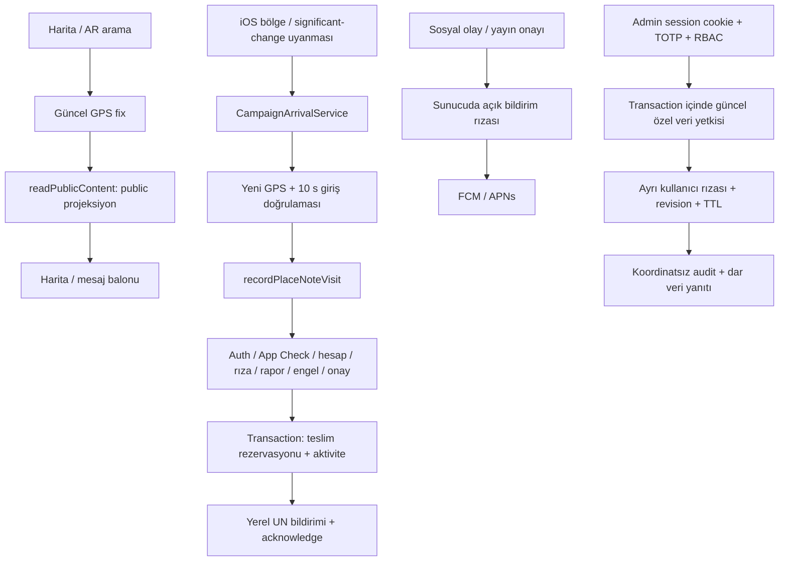

# LociAR — risk, hata ve optimizasyon taraması

14 Ekim 2026. İncelenen başlangıç: `b5e964b0fa0c9fba6b5ee807b9fd79a8c79fac94`. Düzeltme: `976e9b3b7df998abdde4fa91848ed27f845de930`.

**Altı yeni hata düzeltildi: iki P1, dört P2.** Bildirim rızası, admin özel veri yetkisi, şikâyet hedefi/sayfalaması ve ön plandaki GPS araması kapsandı. İki sorgu için birleşik indeks eklendi. Önceki taramaların giderilmiş bulguları yeniden yeni hata sayılmadı.

P1, rıza veya özel veriye erişim sözleşmesini bozar. P2, görünür bir işlevi yanlış durdurur, yanlış içerik gizler veya güncel konum yerine eski konumu kullanır. Bu sınıflandırma gerçek cihazda GPS/bildirim başarısı ya da genel bir güvenlik sertifikası değildir.

## Yeni bulgular ve düzeltmeler

| Kimlik | Sorun ve kullanıcı etkisi | Düzeltme | Kanıt |
|---|---|---|---|
| D1 / P1 — bildirim rızası | Sosyal ve yayın onayı push'ları sadece `notifications === false` değerinde duruyordu. Tercih belgesi olmayan veya null olan hesapta kayıtlı token varsa bildirim gönderilebiliyordu. | Her iki gönderim yolu, transaction içinde tam olarak `notifications === true` ister. Ret durumunda teslim makbuzu ve kota da tüketilmez. | Önce emülatör testi `social consent: undefined: 1 !== 0` ile başarısız oldu. Sonra eksik/null/false/yanlış tip için iki yol da reddedildi; açık rızada iki gönderim geçti. `functions/src/push.ts`. |
| D2 / P1 — admin yetki iptali | Özel konum/teknik veri okuması başlangıçtaki MFA/RBAC nesnesine güveniyordu. Rol bu arada kaldırılırsa veya daraltılırsa eski nesne okumaya izin verebiliyordu. | Veri/audit transaction'ı güncel, iptal edilmemiş rol atamalarını okur; ilgili `users.location.read` veya `users.telemetry.read` yoksa 403 verir. | Önce `Missing expected rejection`. Sonra hem rol daraltma hem iptal, iki özel veri türünde reddedildi; başarılı okuma audit'i oluşmadı. `admin/lib/user-context.ts`. |
| D3 / P2 — yorum şikâyeti post şikâyeti sayılıyor | Yorum raporu, moderasyon ekranında gezinme için ana post ID'sini taşır. Bu kayıt ana postu gizleyebilir, not bildirimini susturabilir ve not aktivitesini saklayabilirdi. | Ortak `isPostReport`/`hasPostReport` politikası yorum, kullanıcı ve otomatik metin filtrelerini ayırır. Otomatik gizleme, ziyaret uygunluğu ve aktivite aynı ayrımı kullanır. | Üç yorum/kullanıcı raporu ana postu aktif tutar. 205 yorum raporu varken bölge/aktivite/ziyaret çalışır; arkadaki gerçek post raporu bunları durdurur. `functions/src/postReports.ts`, `noteAutomation.ts`, `placeNoteAccess.ts`, `anonymousAccess.ts`. |
| D4 / P2 — ilk 100 rapor kalıcı engel oluyor | İlk 100 kaydı tek kullanıcı doldurursa sonraki farklı şikâyetçiler hiç görülmüyordu; gizleme eşiği sağlansa bile post aktif kalabiliyordu. | Belge ID'si ile 200'lük sayfalar okunur. Farklı geçerli post şikâyetçileri eşik tamamlanana veya sorgu bitene kadar sayılır; eşikte tarama durur. | 220 yinelenen raporun arkasındaki iki farklı şikâyetçi önce görülmedi; düzeltmeden sonra post `flagged`, bildirim onayı `revoked`. |
| D5 / P2 — harita/AR eski konumdan arıyor | Durdurulmuş konum akışının son değeri bellekte kalıyordu. Yeniden açma/yenileme eski noktadan hemen sorgu başlatabiliyordu. İptal edilmiş bekleyişler de devam edebiliyordu. | Yeni sorgu yalnız geçerli, en fazla 10 saniyelik fix kullanır. Stop konum/heading/ölçüm tohumlarını temizler; bekleyiş iptale uyar. Yaklaşık konumla harita kullanımı için yeni bir doğruluk sınırı eklenmedi; not bırakma ve girişin mevcut doğruluk kuralları ayrı kalır. | Native test güncel fix'i kabul eder, 11 saniyelik değeri reddeder ve stop sonrası önbelleği boş doğrular. Sonsuz/bozuk ölçüm reddedilir. `LocationController.swift`, `MapFeatureView.swift`, `ARExperienceView.swift`. |
| D6 / P2 — geçici GPS arayışı hata gibi bitiyor | İlk `locationUnknown` callback'i errorMessage üretince harita/AR bekleyişi sonraki ölçüm gelmeden kesiliyordu. | Geçici konum arayışı beklemeyi sürdürür; harita ve AR'nin sınırlı bekleme süreleri geçerlidir. İzin reddi hâlâ kullanıcıya gösterilir. | Yeni native test geçici arayışta hata yok, izin reddinde hata var koşullarını doğrular. |

İlk üç emülatör tekrar üretme testi düzeltme öncesi 3/3 başarısızdı. Admin tekrar üretmesinde 4 testin 3'ü geçti, yetki iptali testi başarısızdı. Bu başarısızlıklar hata kanıtıdır; kabul sayısına dahil edilmedi. Native bulgular kaynak akışı ve sonradan eklenen davranış testleriyle doğrulandı; eski iOS sürümünde fiziksel tekrar üretme yapılmadı.

## Yapılan sorgu optimizasyonu

Canlı Firestore'da varsayılan Query Explain ile iki rapor sorgusunun planı okundu. Her biri iki tek alanlı indeksi birleştiriyordu. Şu birleşik indeksler eklendi:

- `moderation_flags`: `post_id ASC, status ASC` — otomatik gizleme.
- `moderation_flags`: `user_id ASC, post_id ASC` — ziyaretçinin postu raporlayıp raporlamadığı.

**Canlı sonuç:** 26/26 indeks `READY`. Son Query Explain, her iki sorguda da iki ayrı tek alanlı indeks yerine bir birleşik indeks seçildiğini doğruladı: `(post_id, status, __name__)` ve `(user_id, post_id, __name__)`. Önce/sonra planları özel kanıt dosyalarında kayıtlıdır.

Birleşik indeksin amacı, bu iki filtreyi aynı indeks üzerinden karşılamaktır. Bu çalışma canlı yük altında gecikme veya fatura düşüş yüzdesi ölçmez. Varsayılan Query Explain sorguyu çalıştırmadan plan döndürür; gerçek süre/maliyet ölçümü için ayrıca analyze gerekir. [Firebase Query Explain](https://firebase.google.com/docs/firestore/query-explain).

## Kullanıcının bugün yapabildikleri

- Kamera açmadan haritada yakındaki notları görebilir. Harita 1 km içindeki en yakın 100 postu alır; 25 m grupları mesafeye, grup içindeki notları beğeniye göre sunar. Yoğun noktalardaki kilitli içerik, mevcut yerinde açma kuralına tabidir.
- GPS notu bırakmak için AR dünya kilidi veya Cloud Anchor şart değildir. AR yüzeye sabitleme ayrı bir yayın yoludur.
- Yeni GPS notu metin filtresi, korumalı bölge ve kota kontrollerinden sonra yayınlanır. Yayınlanması tek başına bildirim onayı değildir. Varsayılan olarak bir günden eski üç farklı hesabın beğenisi veya admin onayı gerekir.
- Anonim post başka kullanıcıya yazar hesabını/handle'ını göstermeyen projeksiyonla sunulur. Sunucuda moderasyon ve hesap silme için özel `creator_id` tutulur. Admin teknik veri/son konum paylaşımı ayrıca açık rıza gerektirir.
- Kullanıcı not bildirimlerine izin verdiğinde, uygun ve görülmemiş onaylı not için canlı kontrollerden sonra yerel iOS bildirimi kuyruğa alınır. Aynı not aynı hesaba tekrar gönderilmez.

### Mağaza örneğinin teknik sınırı

Güncel not giriş yarıçapı **15–100 m**. Kabul kuralı `mesafe ≤ yarıçap + min(doğruluk, 20 m)`; ölçüm doğruluğu en fazla 35 m, yaşı en fazla 10 s. İçeride en az 10 s devamlı ölçüm gerekir; 5 s'den büyük örnek boşluğu süreyi yeniden başlatır. 300–400 m OS çemberi yalnız uyandırma içindir.

Dolayısıyla 10–15 s hedefi, mağaza kapısından fiziksel giriş anından değil ilk kabul edilen ölçümden başlar. GPS çemberi kaldırıma veya komşu mağazaya taşabilir; kat bilgisi bu not kuralında doğrulanmaz. İç mekânda 2–5 m veya kapalı uygulamada sabit teslim süresi garantisi yoktur. [Apple bölge izleme açıklaması](https://developer.apple.com/library/archive/documentation/UserExperience/Conceptual/LocationAwarenessPG/RegionMonitoring/RegionMonitoring.html).

Arka plana alınma/ekran kilidi, OS'nin uygulamayı sonlandırması ve kullanıcının uygulamayı yukarı kaydırarak zorla kapatması farklı durumlardır. Always, Hassas Konum, bildirim izni, kategori rızası, OS yürütme süresi ve ağ gerekir. Apple'ın güncel açıklamasında force-quit normalde arka planda yeniden başlatmayı engeller; belgelenmemiş istisnalar sürümler arasında değişebilir. BGAppRefresh da sabit aralık garantisi vermez. [Apple DTS](https://developer.apple.com/forums/thread/685525).

## Mimari ve güvenlik sınırları

Yakındaki metadata sorguları, yerel rıza önbelleği, onaylı bölge önbelleği ve teslim günlüğü ayrı işlevlerdir. Önceki GPS düzeltmelerinin tek yenileme flight'ı, eski hesap/revizyon yanıtlarını reddetmesi, bağımsız kaynakların 8 s sorguları, 28 s uyanma bütçesi, kayıtlı bölgeleri çevrimdışı geri kurması ve izin geçişleri bu turda mevcut kaynakta tekrar incelendi; native regresyonlar yeniden geçti.

Önemli sınırlar:

- Sunucu post/counter/moderasyon/hesap silme otoritesidir; callable hatasında doğrudan Firestore fallback yoktur.
- iOS en fazla 18 geliş bölgesi + 2 ayrılmış bölge kullanır. Tek seferde bütün mağazaları izleme garantisi yoktur.
- Olağan yer öğrenimi cihazdadır; ev konumu sunucuya yüklenmez.
- Admin konum paylaşımı yalnız ön planda ve ayrı rızayla çalışır; arka plan not geliş mekanizması bunu açmaz.
- Sunucu GPS fix'ini istemci bildirimi olarak doğrular; App Check tek başına fiziksel mağaza varlığının kanıtı değildir.
- Sosyal push claim-before-send ile tek deneme yapar. Harici FCM sınırındaki kesinti push'ı kaybettirebilir; kalıcı aktivite akışı korunur. Notların yerel teslim rezervasyonu/ack yolu farklıdır.

## Test ve yayın kanıtı

| Kontrol | Sonuç |
|---|---:|
| Native LociARTests — son kaynak | 177/177 |
| Functions birim | 125/125 |
| Functions tam emülatör | 166/166 |
| Firestore + Storage rules | 82/82 |
| Admin birim — son kaynak | 35/35 |
| Admin tam emülatör + HTTP/tarayıcı — build tamamlandıktan sonraki kabul koşusu | 90/90 |
| Repo script regresyonları | 49/49 |
| Yerel toplam | **724/724** |
| Yeni canlı admin üstünde masaüstü/mobil Chromium — 0 retry | 24/24 |
| Otomatik test toplamı | **748/748** |
| Admin production build | geçti |
| Functions/admin production ve tam bağımlılık taraması | temiz |
| Secret scan / diff whitespace | geçti |
| Yerelleştirme | 651 anahtar, 12 dil, 0 needs_review; 616 compiler anahtarı / 82 dosya mevcut |
| Son iOS Release arşivi | archive + codesign deep/strict + Crashlytics symbol upload geçti |

Sekiz yeni regresyon testi eklendi. İlk admin kabul koşusunda build ve HTTP testleri çakıştığı için o 90/90 sonucu son kanıt olarak kullanılmadı; tamamlanan build üstündeki ayrı 90/90 koşusu kabul edildi. Önceki native 176/176 koşusu da son 177/177 sayısına eklenmedi. UI test adları veya simülatör koşusu fiziksel iPhone kanıtı değildir.

Son native paket: `build/LociAR-DeepAuditFinalAccepted-20261014.xcarchive`; test sonucu: `build/DeepAuditFinalAccepted-20261014.xcresult`. Paket Apple Development ile imzalıdır; TestFlight/App Store'a dağıtılmadı veya telefona kurulmadı. iOS düzeltmeleri yeni build kurulunca kullanıcıya ulaşır.

Canlı dağıtım tamamlandı ve API metadata'sıyla ayrıca doğrulandı:

- `onActivityCreated`, `onPostWritten`, `onReportCreated`, `readPlaceNoteRegions`, `recordPlaceNoteVisit`, `readActivity` sırayla güncellendi. Altısının Node.js 22, ACTIVE ve dağıtım başlangıcından yeni güncelleme zamanına sahip olduğu kontrol edildi. Diğer Functions değiştirilmedi.
- Son metadata kontrolü **PASS**: 58 ACTIVE Functions, 32 TTL politikası, 6 zamanlanmış görev. Gerekli 26 birleşik indeksin tamamı READY ve yerel tanımlarla eşleşiyor.
- [Admin](https://lociar-admin--lociar-2f38c.us-central1.hosted.app) yerel kaynak arşivinden yayımlandı: `build-2026-10-14-001` READY; rollout SUCCEEDED; aktif trafik %100 bu build'e gidiyor. CLI başarı mesajı, rollout ve trafik kanıtından ayrı değerlendirildi.
- Yeni canlı sürümde 24 masaüstü/mobil Chromium testi, sıfır hata ve sıfır retry ile geçti. Bu testler gerçek iPhone veya canlı TOTP/özel veri erişimi kanıtı değildir.
- Dört kimliksiz callable POST isteği 401 `UNAUTHENTICATED` ile reddedildi. Canlı post/kampanya üretimi veya gerçek kullanıcı verisiyle mutation testi yapılmadı.
- Canlı `posts` ve `campaigns` sayısı sıfır. Bu ortamda kullanıcı trafiği/p95 bildirim süresi/fatura kazancı ölçülmüş sayılmaz.

Son özel kanıt: `build/deep-audit-20261014/verification.json`. Test logları, kaynak/hash bilgileri, önce/sonra sorgu planları, deployment sonuçları ve trafik snapshot'ı bu klasörde; genel metadata `build/firebase-readiness/deep-audit-final-live-20261014.json` içinde. Kimlik, token veya koordinat bu rapora kopyalanmadı. Kaynak commit yereldir; bu turda GitHub push veya yeni commit için GitHub CI koşusu yapılmadı.

## Kalan öncelikler ve ölçülecek optimizasyonlar

| Öncelik | Kalan iş | Neden / kapanış ölçütü |
|---|---|---|
| Yayın öncesi cihaz kabulü | Gerçek iPhone'da mağaza girişi, komşu mağaza/kat, ekran kilidi, OS sonlandırması, force-quit, yeniden başlatma, Always/Hassas Konum kapatma, zayıf ağ ve bildirim teslimi | Bu turda fiziksel test yapılmadı. Kapıdan giriş → ilk kabul edilen fix → sunucu kabulü → görünen bildirim süreleri ayrı ölçülmeli. |
| Operasyonel ölçüm | Yoğun bölgelerde p95/p99 bölge/ziyaret sorgusu, okunan belge sayısı, hata ve 8 s istemci deadline oranı | 10.000 tarama bütçesi maliyeti sınırlıyor ama 8 s içinde yanıt garantisi vermiyor. Canlı yük testi yapılmadı. |
| Veri aktarımı | Bölge aday sorgusunda yalnız gerekli alanları okumak; AR edit/anchor JSON'larını metadata yenilemesinden çıkarmak | `approvedNear` bugün bütün post dokümanını okur. Alan projeksiyonu aktarım/belleği azaltabilir; belge okuma ücretini aynı oranda düşürdüğü varsayılmamalı. Geohash/polar cursor alanları ve tüm uygunluk kontrolleri korunmalı. |
| Şikâyet kötüye kullanımı | Hedef + kullanıcıya bağlı tekrar önleme ve sunucu kota mekanizması | Yeni sayfalama doğru kararı verir; sınırsız yinelenen rapor üretimini engellemez. Ürün/report akışı ve Firestore rules birlikte değiştirilerek denenmeli. |
| İçerik filtresi dil kapsamı | Desteklenen dillerde uygunsuz içerik ve kaçınma örnekleriyle ölçüm | `functions/src/moderation.ts` minimal Türkçe/İngilizce kelime listesi kullanır; 12 dilde eşdeğer içerik sınıflandırması kanıtlanmış değildir. GPS notları anında yayınlandığından rapor ve insan moderasyonu bu açığı tek başına ilk gösterimden önce kapatmaz. |
| GPS izleme sağlığı | Region registration hata callback'ini, gerçek kayıt sayısını ve yeniden kurma sonucunu ölçmek | `monitoringDidFailFor` için özel uygulama geri bildirimi yok. İzinler açıkken OS kayıt hatası sessiz kalabilir. Telefon koşusunda kayıt başarısı ve yeniden kurma ayrıca doğrulanmalı. |
| Enerji | Hassas pencerenin batarya/ısı etkisi ve harita/AR konum yöneticisinin arka plan davranışı | Kodda bitiş/iptal/izin cleanup var; gerçek cihaz enerji profili yok. Hedef bittikten sonraki standart/precise stream durumu ölçülmeli. |

Bu kalanlar için süre, fatura veya cihaz başarısı yüzdesi uydurulmadı. Sonraki optimizasyonun önceliği canlı sorgu ve cihaz ölçümleriyle belirlenmeli.
