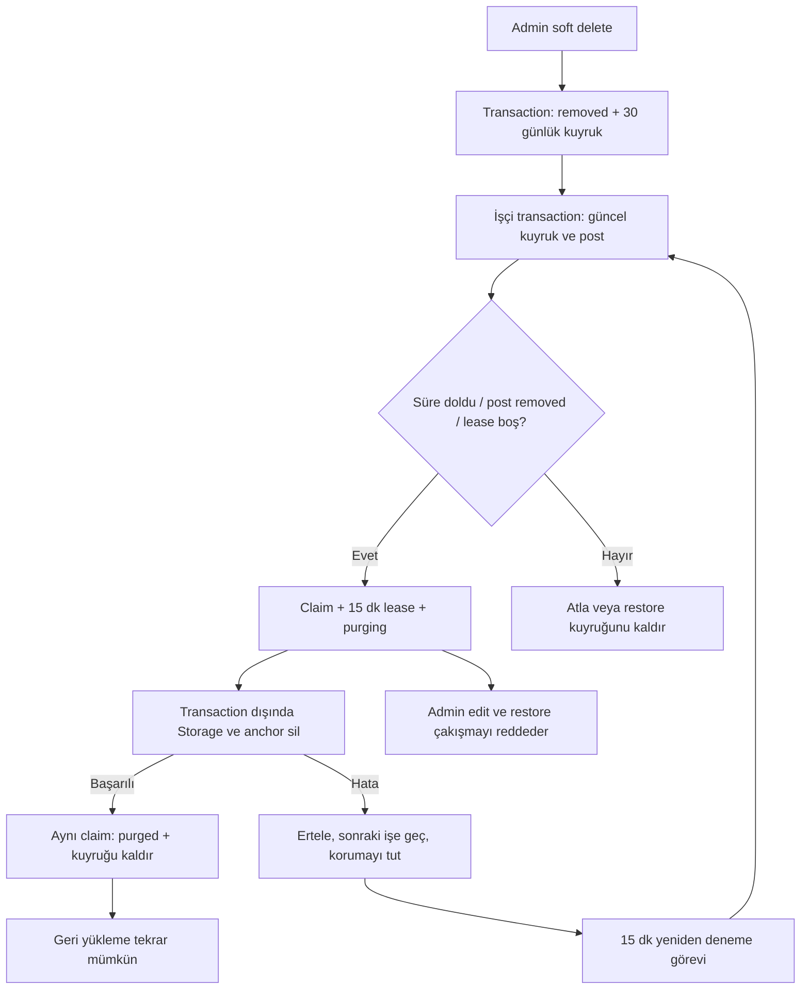

# LociAR — ikinci derin risk ve optimizasyon taraması

14 Ekim 2026. Başlangıç: `403de848f`; düzeltme kaynağı: `48092d46e4506b8aaaa8fe78b0700a3494ab438b`.

Bu inceleme, [önceki altı bulguluk taramayı](DEEP_RISK_AUDIT_2026-10-14.md) tamamlar. Yeni odak: admin geri yükleme ile medya silme arasındaki yarışlar, arka plan bölge kaydının sağlığı ve not metadata sorgularının veri aktarımı. Eski düzeltmeler yeni bulgu sayılmadı.

## Kullanıcıya etkisi

- iOS bir bildirim bölgesini kaydedemezse uygulama artık hazırmış gibi görünmez. Ayarlarda uyarı ve tekrar deneme bulunur. Geçici kayıt hataları bölge başına 1, 5 ve 15 saniye sonra en fazla üç kez denenir.
- Eski hesap, kaldırılmış alan veya değişmiş çember için gecikmiş callback, güncel alanın durumunu bozamaz. Hesap değişimi ve özelliği kapatma, bekleyen denemeleri temizler.
- Kamera açmadan haritadaki notları görme ve AR dünya kilidi olmadan GPS notu bırakma davranışı korunur. Kullanıcı notları ölçülen GPS konumuna bağlıdır; mevcut belirsiz konumu pinle doğrulama yolu ve 50 m taşıma sınırı korunur. Bu turda işletme seçimi veya kapı/kat algılama eklenmedi.
- Admin, medya temizlenirken içeriği geri yükleyemez veya düzenleyemez. İş bittikten sonra geri yükleme mümkündür; silinmiş eski AR haritası geri oluşmaz, mevcut yaklaşık gösterim yolu kullanılır.
- Arka plan not geliş mekanizması adminle konum paylaşma rızasını açmaz. Olağan yer öğrenimi cihazda kalır. Anonim postun public projeksiyonu ve sunucudaki özel moderasyon kimliği ayrımı korunur.

## Somut bulgular ve düzeltmeler

| Bulgu | Etki | Düzeltme ve kanıt |
|---|---|---|
| F1 / P2 — geri yükleme ve Storage silme yarışı | İşçi `removed` okuduktan sonra admin geri yükleyebilir; devam eden silme aktif postun AR medyasını yok edebilirdi. | Firestore transaction, kuyruk işini sahiplenir ve posta `media_purge_state: purging` yazar. Admin moderasyon ve edit işlemleri aynı postu transaction içinde kontrol edip çakışmayı reddeder. Tekrar üretme testi eski kaynakta geri yüklemeye izin verildiğini gösterdi; son kaynak temizleme sırasında reddeder, tamamlandıktan sonra kabul eder. |
| F2 / P2 — eski kuyruk snapshot'ı yeni silmeyi erken tüketiyor | Sorgu sonucu beklerken post geri yüklenip yeniden silinirse eski iş yeni 30 günlük bekleme süresini atlayabilirdi. | İşçi işlem öncesi kuyruk belgesini yeniden okur. Admin geri yükleme/approve/flag işlemi kuyruğu atomik kaldırır; yeni soft delete yeni son tarih oluşturur. Eski snapshot ve hızlı restore/re-remove regresyonları geçer. |
| F3 / P2 — eşzamanlı işçiler / gecikmiş olay | Gece temizliği ile yeniden deneme aynı işi alabilir; gecikmiş status olayı mevcut sahipliği silebilirdi. | Rastgele `claim_id` ve 15 dakikalık lease. Aktif lease yeniden alınmaz. Tamamlama yalnız kendi claim'ini kaldırır. Status trigger merge ile lease'i korur. İki işçinin bir Storage silmesine indiği ve gecikmiş olayın claim'i koruduğu doğrulandı. |
| F4 / P2 — tek başarısız silme sonraki işleri durduruyor | Bir Storage/anchor hatası bütün döngüyü keser; sonraki işler gece koşusuna kadar bekleyebilirdi. | Her iş ayrı yakalanır, kendi claim'iyle yeniden zamanlanır ve sonraki işe geçilir. Yeni `retryRemovedMedia` 15 dakikada bir, en çok 20 aday işle işler. Test bir hatalı işi ertelerken sonraki sağlıklı işi tamamlar; ertelenen iş sonraki denemede tamamlanır. |
| F5 / P2 — bölge kayıt hatası sessiz kalıyor | İzinler açık olsa bile OS kaydı başarısızken ayarlar hazır gösterebilirdi. | `monitoringDidFailFor`, istenen bölge kayıtları, sınırlı retry, başarı callback'i ve kullanıcı uyarısı eklendi. Crashlytics yalnız teknik domain ve sayısal hata kodunu alır; alan ID'si ve koordinat eklenmez. Policy testleri retry sınırını, başarı temizliğini ve eski geometri callback'inin reddini doğrular. Gerçek OS callback testi fiziksel cihazda yapılmadı. |
| F6 / P2 — cihazın desteklemediği yarıçap | Yenileme alanı 1–3 km olabiliyordu; cihazın `maximumRegionMonitoringDistance` değeri daha küçükse OS kaydı reddedebilir. | Yenileme alanı cihaz sınırına indirilir. Gerçek kampanya alanı sessiz küçültülmez; desteklenmeyen, sıfır/sonsuz/bozuk yarıçap açık kayıt hatası olur. Native regresyon testi geçer. |
| O1 — büyük AR verisi metadata yoluna taşınıyor | Bölge ve ziyaret sorgusu gereksiz edit/anchor/calibration JSON'larını okuyordu. | `approvedNear` yalnız uygunluk, geohash/polar sayfalama, sıralama ve bildirim gövdesinin gerektirdiği alanları seçer. Normal ve kutup koordinatında callable sonucu, caption ve likes korunur. |

Storage ve anchor I/O, yeniden denenebilen Firestore transaction'ın dışında çalışır. Kuyruk prefix'i geçerli yaratıcı/post UUID'leriyle eşleşmek zorundadır. 15 dakikalık lease, 540 saniyelik işçi deadline'ından uzundur. Harici hata sonrası postun `purging` koruması başarılı yeniden denemeye kadar kalır; kısmen silinmiş medyayı geri yükleme yarışına açmaz. Zamanlanmış görev sıklığı başarılı bitiş için kesin süre garantisi değildir.

İlk iki doğru kurulmuş eski kaynak testi **2/2 başarısız** oldu: temizleme sırasında geri yükleme kabul edildi ve eski snapshot gelecekteki işi sildi. Daha önceki yanlış modül yolundan doğan test başlatma hatası, ürün hata kanıtı veya kabul sonucu sayılmadı. Son admin regresyonları beş senaryoyu kapsar. I/O mock'u içindeki assertion işçinin catch bloğunda yutulmasın diye gözlemler kaydedilip testin dış akışında doğrulanır.

Apple, cihazın azami bölge yarıçapını aşmanın kayıt hatasına neden olabileceğini ve hata callback'ini belgeler. [Azami izleme mesafesi](https://developer.apple.com/documentation/corelocation/cllocationmanager/maximumregionmonitoringdistance), [kayıt hata callback'i](https://developer.apple.com/documentation/corelocation/cllocationmanagerdelegate/locationmanager(_:monitoringdidfailfor:witherror:)). Firestore transaction'ları çekişmede yeniden çalışabilir; harici silmeyi transaction dışında tutma gerekçesi budur. [Firebase transaction açıklaması](https://firebase.google.com/docs/firestore/manage-data/transactions).

## Ölçülen optimizasyon

İki emülatör postu, her birinde büyük edit/anchor/calibration JSON'u taşıyacak şekilde kuruldu. Biri normal geohash, biri kutup sayfalamasını kullandı. Tam doküman ve projeksiyon verisinin JSON boyutu aynı testte ölçüldü:

| Aynı iki test dokümanı | Bayt |
|---|---:|
| Tam dokümanlar | 1.201.016 |
| Metadata projeksiyonu | 612 |
| Bu örnekte azalma | %99,949 |

Bu oran yapay büyük AR verisi içeren test örneğine aittir. Canlı bütün postlar için aynı oran, p95 gecikme veya fatura kazancı iddiası değildir. Alan projeksiyonu, belge okuma ücretini aynı oranda düşürmez. Geohash, lat/lng, tüm uygunluk alanları, likes/created_at sıralaması ve caption/spot_id korunmuştur.

## Doğrulama

| Kontrol | Son kaynak sonucu |
|---|---:|
| Native LociARTests | 180/180 |
| Functions birim | 125/125 |
| Functions tam emülatör | 167/167 |
| Firestore + Storage rules | 82/82 |
| Admin birim | 35/35 |
| Admin tam emülatör + HTTP | 95/95 |
| Repo script regresyonları | 49/49 |
| Yerel toplam | **733/733** |
| Yeni canlı admin üstünde masaüstü/mobil Chromium — 0 retry | 24/24 |
| Otomatik test toplamı | **757/757** |

Dokuz yeni regresyon eklendi: üç native, beş admin ve bir Functions. Tekrarlanan koşular ve eski kaynakta başarısız testler toplama eklenmedi. Son admin HTTP kabul koşusu production build bittikten sonra çalıştı.

Admin production build, Functions/admin bağımlılık taramaları, secret scan, diff ve release yerelleştirme kontrolleri geçti. Yeni mesaj 12 dilde üretildi: 652 toplam anahtar, 0 needs_review; Debug simulator build'inde 617 compiler anahtarı / 70 kaynak dosyası. Crashlytics teknik hata domain'i UI anahtarı sayılmaz.

Yeni native test paketi `build/FollowupAuditAccepted-20261014.xcresult`. Release arşivi `build/LociAR-FollowupAuditAccepted-20261014.xcarchive`: archive, deep/strict codesign ve Crashlytics symbol upload geçti. Apple Development ile imzalıdır; telefona kurulmadı, TestFlight/App Store'a dağıtılmadı. iOS düzeltmeleri yeni build kurulunca kullanıcıya ulaşır.

## Canlı yayın

Adminin temizleme kilidi önce aktif trafiğe geçmelidir. Sonra `onPostWritten`, `cleanupPostMedia`, `retryRemovedMedia`, `readPlaceNoteRegions`, `recordPlaceNoteVisit` tek tek yayımlanır. Bölge veya güvenlik kuralları değiştirilmez.

Admin yerel kaynak arşivinden yayımlandı: `build-2026-10-14-002` READY, rollout SUCCEEDED, trafik %100 bu build'de. Yeni backend işçileri bu kanıt alınmadan başlatılmadı. Yeni admin üstünde 24 masaüstü/mobil Chromium testi sıfır hata ve retry ile geçti; canlı TOTP oturumu veya fiziksel iPhone testi değildir.

İlk App Hosting denemesi bucket okuma hatasıyla durdu. Sonraki debug denemesi Cloud Storage'dan 503 `backendError` gösterdi. Aynı yetkili API'ye tam bucket listesiyle erişim yeniden başarılı olduktan sonra üçüncü standart CLI denemesi tamamlandı. Kurallar veya IAM izinleri zayıflatılmadı; başarısız deneme logları da özel kanıtta korundu.

Beş backend işlevi tamamlandı: `onPostWritten`, `cleanupPostMedia`, `retryRemovedMedia`, `readPlaceNoteRegions`, `recordPlaceNoteVisit`. Sonuncunun ilk denemesi Functions listeleme adımında durdu; canlı REST listelemesi başarılı olduktan sonra yalnız bu işlev yeniden yayımlandı. Son snapshot, beşinin de ACTIVE, Node.js 22 ve dağıtım başlangıcından yeni `updateTime` değerine sahip olduğunu doğrular.

Son canlı metadata kontrolü **PASS**: 59 ACTIVE Functions, 32 TTL politikası, 7 zamanlanmış görev. Yerel tanımlarla eşleşen 26 gerekli birleşik indeksin tümü READY. `retryRemovedMedia` ENABLED, `every 15 minutes`, Europe/Istanbul; anonim IAM erişimi yok, Scheduler'ın kimliği `roles/run.invoker` ile eşleşiyor. Bu metadata/auth kontrolüdür; canlı gerçek kullanıcı verisiyle temizleme testi yapılmadı.

Değişen iki callable'a kimliksiz POST, 401 `UNAUTHENTICATED` ile reddedildi. Son snapshot'ta `posts` ve `campaigns` sayısı sıfır; bu ortamda mağaza bildirimi, yoğun canlı trafik, p95 gecikme veya fatura kazancı ölçülmüş sayılmaz.

Son özel kanıt `build/followup-audit-20261014/verification.json`. Kabul edilen logların hash'leri, 25 kaynak dosyasının hash'leri, arşiv hash'i, başarılı/başarısız deployment kayıtları, IAM/Scheduler eşleşmesi ve son trafik snapshot'ı aynı klasördedir. Genel metadata `build/firebase-readiness/followup-audit-final-accepted-20261014.json` içindedir. Fiziksel cihaz doğrulaması ve dağıtım bu kanıtta açıkça false olarak kayıtlıdır.

## Kalan riskler ve kapanış ölçütleri

| Öncelik | Açık konu | Kanıt / gerekli kabul |
|---|---|---|
| Yayın öncesi cihaz kabulü | Mağaza girişi ve arka plan bildirimi | Fiziksel iPhone testi ertelendi. Kapıdan giriş, ilk geçerli ölçüm, server kabulü ve görünür bildirimin süreleri ayrı ölçülmeli. Ekran kilidi, OS sonlandırması, force-quit, yeniden başlatma, ağ/izin değişimleri ve komşu mağaza/kat kapsanmalı. |
| Kötüye kullanım | Şikâyet tekrarları ve çoklu hesaplar | `moderation_flags` oluşturma hedef+kullanıcı tekilliği veya sunucu kotası zorunlu kılmıyor. Otomatik gizleme farklı UUID'leri sayıyor; şikâyetçi için beğeni onayındaki 24 saat hesap koşulu yok. Yinelenen belgeler maliyet yaratabilir; farklı hesaplarla gizleme kötüye kullanımı ayrıca tasarlanıp denenmeli. Aynı kişinin üç raporu üç farklı kişi sayılmaz. |
| İçerik filtresi | 12 dilde eşdeğer moderasyon | `moderation.ts` hâlâ minimal Türkçe/İngilizce kelime listesi kullanıyor. Diğer diller ve kaçınma örnekleri için ölçülmüş kapsama yok. Anında yayınlanan notlarda ilk gösterim öncesi moderasyon kalitesi ayrıca tamamlanmalı. |
| Operasyonel ölçüm | Yoğun bölge gecikmesi ve maliyet | 10.000 aday tarama bütçesi, 8 saniyede yanıtı garanti etmez. Field mask aktarımı azaltır; yoğun bölgede p95/p99, okunan belge sayısı ve deadline oranı ayrıca ölçülmeli. |
| Enerji | Hassas pencere / aynı anda açık konum yöneticileri | Gerçek cihaz batarya, ısı ve GPS akışlarının bitiş profili ölçülmedi. Policy/simülatör testi enerji kanıtı değildir. |
| SDK bakımı | FirebaseMessaging token API'leri | Pinned SDK header'ında `token` ve `deleteToken` deprecated; yeni register callback'i token döndürmüyor. Basit isim değiştirme doğru değil. APNs token, Auth oturumu, rıza ve unregister fencing korunarak ayrı migration ve cihaz testi gerekir. Mevcut build geçer; bu uyarı tek başına gönderim arızası kanıtı değildir. |
| Temizleme ölçeği | Büyük Storage prefix'leri | Yeni iş bütçesi/lease arızayı ayırır; `deleteStoragePrefix` içindeki tüm nesneleri listeleme yaklaşımının çok büyük hesap/prefix bellek maliyeti bu turda değiştirilmedi. Sayfalı silme ve timeout kabulü yük örnekleriyle ele alınmalı. |
| Güvenilir teslim | FCM dış servis sınırı | Sosyal push claim-before-send yolu, dış servis sınırında kesinti olursa push kaybedebilir; aktivite kaydı korunur. Notların yerel rezervasyon/ack yolu ayrı. Fiziksel teslim tamlığı bu turda ölçülmedi. |

Notların güncel giriş alanı **15–100 m**; `mesafe ≤ yarıçap + min(doğruluk, 20 m)`, doğruluk ≤35 m ve ölçüm yaşı ≤10 s. Devamlı 10 s doğrulama ilk kabul edilen ölçümle başlar; 5 s üzerindeki örnek boşluğu süreyi yeniden başlatır. 300–400 m OS alanı yalnız uyandırma içindir. Bu GPS çemberi fiziksel mağaza kapısı, kat veya 2–5 m konum kanıtı değildir.

Kullanıcının uygulamayı yukarı kaydırarak zorla kapatması, arka plana alma/ekran kilidinden farklıdır. Apple'ın açıklamasına göre force-quit normalde arka planda yeniden başlatmayı engeller; sabit 10–15 saniye teslim veya her kapanış durumunda konum alma garantisi verilemez. [Apple DTS](https://developer.apple.com/forums/thread/685525). İzinler açıkken yeni kayıt sağlığı ve retry yardımcı olur; OS yürütme süresi veya GPS doğruluğu üretmez.

Özel kanıt klasörü: `build/followup-audit-20261014/`. Kimlik, token veya kullanıcı koordinatları rapora kopyalanmaz. Bu tur GitHub push veya yeni commit için GitHub CI çalıştırma kapsamı değildir.
