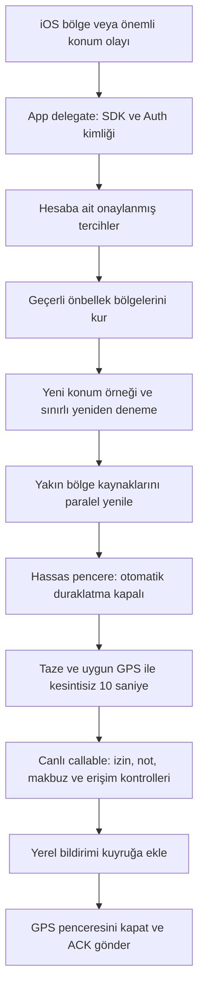

# GPS ve uygulama kapalıyken konum bildirimi — 13 Ekim 2026

GPS ölçümünden iOS uyanmasına, izin geçişlerinden soğuk açılış ve bildirim teslimine kadar akış incelendi. Aşağıdaki dokuz kod/akış riski giderildi. Bu, fiziksel iPhone'da her koşulda bildirim garantisi anlamına gelmez.

## Bulunan ve giderilen riskler

| Alan | Önceki risk | Düzeltme ve kanıt |
| --- | --- | --- |
| G1 — sürekli ölçüm | Otomatik duraklatma varsayılan açık; hassas pencere sırasında GPS akışı durabilir. Always sonradan verilince arka plan bayrağı eski kalır | Konum planı her izin/foreground geçişinde yeniden uygulanır. Hassas pencerede otomatik duraklatma kapalı; Always varsa arka plan güncellemesi ve activity session açık. Hedef bitince kapanır. Plan regresyonu geçti |
| G2 — ilk izin | Bildirimleri ilk açan kullanıcıya When In Use sorulur; Always isteği sonraki yetki durumunda devam etmez | Yalnız açık kullanıcı talebi, kategori etkinliği ve aktif uygulama ile bir kez Always yükseltmesi yapılır. İlk izin penceresi kapanana kadar bekler; arka plan/önbellek açılışı izin istemez. İzin akışı regresyonu geçti |
| G3 — soğuk açılış | Erken kurulum `.location` açılışıyla sınırlı; silent push/BG task ve geç yüklenen Auth kimliği sahne kurulumuna bağımlıdır. Geçici nil Auth, OS bölgelerini silebilir | Tüm açılışlar aynı SDK/hesap kurulumunu kullanır. Auth ilk callback'i izlenir; geçici nil kurulumda bölge silinmez. Gerçek çıkışta silinir. BG/silent push Auth hazır oluşunu kısa ve sınırlı bekler; profile bootstrap ağına bağımlı değildir. Native build geçti; gerçek soğuk uyanma telefon testi bekliyor |
| G4 — önbellek | Kayıtlı bölgenin OS kaydı yoksa yalnız state istemek yetmez; yeniden kurma ağ sorgusunun başarısına bağlıdır | Aynı hesabın onaylanmış, süresi geçmemiş ve etkin kategoriye ait bölgeleri ağdan önce yeniden kurulur. Eksik kayıt, değişmiş çember, mevcut çemberin state isteği ve hesap değişimi regresyonları geçti |
| G5 — yenileme yarışı | Sorgu çalışırken gelen yeni konum isteği düşer; eski yanıt eski çevreyi yeniden kurabilir. Kampanya sorgusu hatası not sorgusunu engeller | Tek flight ve bekleyen yenileme turu; eski revizyon yayınlanmaz. Hesap değişimi eski işi iptal eder. Üç bağımsız bölge kaynağı paralel okunur; hata veren kaynağın önbelleği korunurken diğer başarılı kaynaklar uygulanır. İki async yarış regresyonu geçti |
| G6 — uyanma sonrası eski GPS | Boundary/expired-region olayı güncel ölçüm gelmeden 240 saniyelik önbellek konumuyla çevreyi sorgulayabilir; bir kez başarısız ölçüm yeni sorguyu geciktirir | Uyanma yeni ölçüm ister; uyanmadan en fazla bir saniye önceki örnek kabul edilir. Eski çevre koordinatı ile yeni çevreye geçmiş gibi işlem yapılmaz. 2/5/10. saniyede sınırlı ölçüm tekrarları ve en fazla 28 saniyelik refresh lease kullanılır. Eski ama normal aramada kullanılabilir örneğin uyanmada reddi test edildi |
| G7 — ölçüm seçimi ve ortalama | Callback'in son elemanı geçerli/en yeni olmayabilir. ±180° boylam aritmetik ortalaması konumu Greenwich'e taşıyabilir; çok büyük doğruluk değeri ağırlık hesabını taşırabilir | Geçerli, taze örnekler arasından zaman damgasıyla seçim; coarsede ≤1000 m doğruluk. Göreli ters varyans ve küresel ortalama kullanılır. Bozuk/stale/future paket kuyruğu, tarih değiştirme çizgisi ve sayısal taşma regresyonları geçti |
| G8 — süre ve iptal | 30 saniyelik RPC, 20 saniyelik bildirim işleme penceresini aşabilir. Süresi dolan BG task başarılı raporlanabilir; eski iş yeni hesabın flight'ını temizleyebilir | Bölge/not ziyareti RPC'si 8 saniye; kaynaklar paralel. Expiration/cancellation geç gelen yanıtın uygulanmasını engeller; eski lease UUID'si yenisini kapatamaz. Gerçek sonuç BG task/silent push sonucuna yansıtılır. Account-flight regresyonu ve native build geçti |
| G9 — uzun pencere | Kampanya dwell adımı ortak pencereyi 30 dakikaya uzatabilir; notun sürekli doğrulaması sunucunun 600 s sınırını aşar ve sürekli reddedilir | Not doğrulaması 600 s aşılınca sıfırlanır ve yeni kesintisiz 10 s ister. Sürekli örneklerle 602/612 s regresyonu geçti; sunucu sınırı değişmedi |

İki kategori de kapalıysa refresh boundary ve topic de kaldırılır. Yöneticiye teknik/konum paylaşımı ayrı izin ve yalnız ön plan kuralını korur; bu çalışma arka planda yönetici konum paylaşımı eklemedi. Kullanıcı konum geçmişi yazılmaz; usual-place verisi cihazda ve yalnız kampanya izniyle kalır.

## Kapalı uygulamada akış

Notun GPS alanına giriş bildirimi **yerel bildirimdir**; metin sunucunun güncel kontrolünden sonra döner. APNs/FCM, sosyal bildirimler ve yeni not/kampanya için sessiz bölge yenileme sinyali sağlar. Dolayısıyla bir APNs token'ının varlığı veya canlı Functions metadata'sının yeşil olması, fiziksel mağaza girişinde yerel bildirimin teslimini tek başına kanıtlamaz.

## Gerçek sınır

| Uygulama/telefon durumu | Beklenen davranış ve doğrulama sınırı |
| --- | --- |
| Açık uygulama | İzin varsa foreground ölçüm; hedef yanında hassas pencere |
| Arka plan / kilitli ekran | Always, Precise Location, bildirim izni, uygun sistem ayarları ve internet ile bölge uyanması + konum penceresi desteklenir. Telefon ölçümü henüz yapılmadı |
| OS bellek nedeniyle kapatmış | Konum olayıyla yeniden açılırsa sahne task'ını beklemeden hesap/manager/önbellek kurulur. Telefonla relaunch testi henüz yapılmadı |
| Kullanıcı zorla kapatmış / yeniden başlatma sonrası ilk kilit açılmamış / izin veya sistem erişimi kısıtlı | Uyanma ve zamanında konum teslimi garanti edilmez; uygulama OS kararını aşamaz |

Apple, [arka plan konum yaşam döngüsünde](https://developer.apple.com/documentation/corelocation/handling-location-updates-in-the-background) servislerin yeniden kurulmasını ve uygun yetkilendirmeyi gerektirir. [DTS arka plan sınırları](https://developer.apple.com/forums/thread/685525), zorla kapatma sonrası çalışmanın genel olarak engellendiğini ve istisnaların zamanla değiştiğini açıklar. [Otomatik duraklatma](https://developer.apple.com/documentation/corelocation/cllocationmanager/pauseslocationupdatesautomatically) ve [arka plan güncelleme bayrağı](https://developer.apple.com/documentation/corelocation/cllocationmanager/allowsbackgroundlocationupdates) uygulama kodundan doğru yönetilmelidir; bunlar OS'nin çalışma garantisi değildir.

GPS çemberi 15–100 m, giriş doğruluğu en fazla 35 m, doğruluk katkısı en fazla 20 m, ölçüm boşluğu en fazla 5 s ve doğrulama 10 s kalır. Sahte/simüle ölçümler gerçek cihazda kabul edilmez. Mağaza kapısı, yan yana mağazalar veya kat ayrımı GPS ile kesin saptanmaz. 10–15 s hedefi uygun ilk GPS örneğinden başlar; kapıdan giriş anından itibaren garanti değildir. Kamera/AR/world lock GPS notunda zorunlu değildir.

## Doğrulama

- Hedefli tam native paket: **174 test, sıfır hata**; 12 yeni regresyon. `build/GPSBackgroundAccepted-20261013.xcresult`, `TEST SUCCEEDED` ve exit 0.
- İlk denemede test fixture'ının immutable `lat` alanını değiştirme hatası düzeltildi; üretim kaynakları derlendi. Geniş simulator UI çalışması ayrıca başlatıldı; GPS kapsamı için durduruldu. Bu yarım UI paketi tam başarı veya fiziksel cihaz kanıtı olarak sayılmadı.
- Yerelleştirme: 647 uygulama anahtarı ×12 dil; toplam 651 anahtar, sıfır review. Compiler'ın çıkardığı 616 anahtarın tamamı katalogda.
- İmzalı Release arşivi: `build/LociAR-GPSBackgroundAccepted-20261013.xcarchive`; archive ve `codesign --verify --deep --strict` geçti, Crashlytics sembolleri yüklendi. Paket Info.plist'inde `location`, `remote-notification`, `fetch`, BG task identifier ve iki konum kullanım açıklaması doğrulandı.
- Bu tur değişiklikler iOS tarafındadır; yeni sürüm henüz kullanıcılara dağıtılmadı. Telefonda eski uygulama bu düzeltmeleri kullanmaz.
- Canlı Firebase metadata: **PASS, sıfır bulgu**; 58 Functions aktif, 32 TTL ve 6 zamanlayıcı kaynak yapılandırmasıyla uyumlu. Rapor `build/firebase-readiness/gps-background-live-20261013.json`. Backend kaynakları bu tur değişmedi; yeniden deploy gerekmedi. Metadata, fiziksel GPS/APNs veya gerçek admin oturum testi değildir.

Fiziksel iPhone çalışması önceki kullanıcı talebiyle sonraya bırakılmıştır. Gerekli cihaz kabulü: açık/kilitli ekran, OS relaunch, kullanıcı force-quit, reboot + ilk unlock, bildirim/Always/Precise/Background Refresh izinleri, Wi‑Fi→mobil ağ, kısa ağ kesintisi, indoor/outdoor giriş, 10 s kesintisiz örnek ve çıkışta pencere kapanışı. Aynı notun ikinci kez bildirilmediği de ölçülmelidir.

Kanıt dizini: `build/gps-background-audit-20261013/` (yalnız kullanıcı erişimi). Başlangıç kaynak commit'i `88f434a`; nihai düzeltme commit'i ve log hash'leri `verification.json` içindedir.
