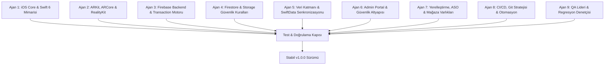

# LociDrop Multi-Agent Kapsamlı Büyük Refaktör ve Yayın Strateji Planı

**Tarih:** 2026-11-02  
**Sürüm:** 1.0.0 (RC Plan)  
**Hedef Ortam:** iOS 17.0+ (Swift 6 Strict Concurrency) | Firebase App Hosting / Cloud Functions | Admin Next.js  
**Yaklaşım:** 9-Ajanlı Çoklu Mimari ve Aşamalı Güvenlikli Refaktör (Phase-Gated Refactoring Protocol)

---

## Yönetici Özeti ve Temel İlke

Bu plan, LociDrop projesini hem **App Store Yayın Olgunluğuna (Store-Ready)** ulaştırmak hem de kod tabanını uzun vadeli ölçeklenebilir, bakımı kolay ve kurşun geçirmez bir mimariye kavuşturmak için hazırlanmıştır.

> [!IMPORTANT]
> **Refaktör Temel Kuralı: "Test Güvenceli Dönüşüm" (Zero-Regression Guarantee)**  
> Mevcut 305 otomatik test (65 betik + 192 Functions + 48 Admin) ve Xcode Swift Concurrency derleme kapısı her aşamanın giriş ve çıkışında çalıştırılacaktır. Hiçbir refaktör adımı, mevcut testleri bozarak veya atlayarak tamamlanamaz.

---

## 1. 9-Ajan Görev Dağılımı ve Roller

---

## 2. Aşamalı Refaktör ve İyileştirme Planı (5 Aşama)

### AŞAMA 1: Kritik Çalışma Zamanı ve Çökme Önleyici Düzeltmeler (P0/P1 Micro-Fixes)
*Bu aşama, refaktör öncesinde sistemdeki bilinen tüm çalışma zamanı pürüzlerini sıfırlar.*

1. **iOS Arka Plan Watchdog Çökme Koruması (`CampaignArrivalService.swift`):**
   - `beginBackgroundTask` içindeki `expirationHandler` bloklarında asenkron `Task { @MainActor ... }` atlama kaldırılacak; `UIApplication.shared.endBackgroundTask(id)` çağrısı senkron ve anında çalıştırılacak.
2. **ARKit Oturum Arka Plan Koruması (`ARPinningEngine.swift`):**
   - `UIApplication.didEnterBackgroundNotification` dinleyicisinde `view.session.pause()` çağrısı kuyruğa alınmadan doğrudan ana iş parçacığında senkron tetiklenecek; `mediaserverd` kamerayı açık tutma çökmesi (`0x8badf00d`) önlenecek.
3. **Ekran Kilitlendiğinde GPS Kapatma (`ARExperienceView.swift`):**
   - Görünüme `scenePhase` dinleyicisi eklenecek, uygulama arka plana geçtiğinde veya ekran kilitlendiğinde `location.stop()` otomatik çağrılarak batarya sızıntısı ve arka plan ihlalleri engellenecek.
4. **Çift Gönderi (Duplicate Post) Önleme (`SyncQueueProcessor.swift`):**
   - `repository.publish(post)` başarılı olduğunda `guard !Task.isCancelled` kontrolünden bağımsız olarak yerel `modelContext.delete(record)` ve `save()` işlemi koşulsuz çalıştırılacak.

---

### AŞAMA 2: iOS İstemci Mimarisi Büyük Refaktörü (Ajan 1, Ajan 2, Ajan 5)
*Monolitik dosyaların parçalanması, katı aktör izolasyonu ve bellek yönetimi optimizasyonu.*

1. **`AppContainer` ve Bağımlılık Enjeksiyonu (DI) Ayrıştırması:**
   - **Mevcut Durum:** `AppContainer.swift` tüm servisleri tek bir dev nesnede başlatıyor.
   - **Hedef:** `AppCoreContainer`, `ARFeatureContainer`, `SocialFeatureContainer` ve `LocationFeatureContainer` şeklinde protokollere dayalı alt modüllere (domain-driven micro-containers) bölünmesi.
2. **Swift 6 Katı Eşzamanlılık (Strict Concurrency) Temizliği:**
   - `ARCoreService.swift` içerisindeki `ARCoreLocationAuthDelegate` sınıfında `@unchecked Sendable` yerine aktör korumalı (`@MainActor` veya kilit mekanizmalı) yapıya geçilmesi.
   - `SendableARFrame` hilesi kaldırılarak `ARSession.delegateQueue = .main` ile ARFrame'lerin iş parçacıkları arasında kaçırılmadan doğrudan main thread'de tüketilmesi.
3. **RealityKit GPU Doku Belleği Sızıntı Çözümü (`SpatialContentRenderer.swift`):**
   - Her render ve çeviri işleminde rastgele UUID (`lociar-\(post.id)-\(generation)`) ile oluşturulan yeni texture'lar yerine post kimliğine bağlı deterministik doku anahtarlama ve eski dokuları GPU önbelleğinden serbest bırakma mekanizması.
4. **Görünüm-Durum (View-ViewModel) Ayrıştırması:**
   - `ARExperienceView.swift` ve `MapFeatureView.swift` içindeki 800+ satırlık doğrudan iş mantıkları dedicated `@Observable` ViewModel sınıflarına (`ARExperienceViewModel`, `MapFeatureViewModel`) taşınacak.

---

### AŞAMA 3: Arka Plan & Cloud Functions Büyük Refaktörü (Ajan 3, Ajan 4)
*İşlem atomikliği, tip paylaşımı ve rate-limiting güvenliği.*

1. **Firestore Güvenlik Kuralları `get()` Bütçe Sadeleştirmesi (`firestore.rules`):**
   - `postIsPublicActive()` içindeki iç içe `profiles/$(creator_id)` okuması kaldırılarak doğrudan gönderi seviyesindeki `status == 'active'` ve `deleted_at == null` bayraklarına dayanılacak. Böylece `likes`, `post_saves` ve `comments` kuralları katı **<= 2 `get()`** bütçesine çekilecek.
2. **Storage Güvenlik Kuralı Yetkilendirme Düzeltmesi (`storage.rules`):**
   - `mapAccess` fonksiyonundaki `account_access/$(luid)` kontrolü, talep eden kullanıcının kendi yetki durumunu doğrulayacak şekilde `account_access/$(request.auth.token.luid)` olarak güncellenecek.
3. **Stripe Webhook Hata Ayrıştırması (`supportStripe.ts`):**
   - Silinmiş içerik üreticileri veya kalıcı iş mantığı hatalarında HTTP 503 döndürme davranışı sonlandırılacak. 72 saatlik Stripe retry fırtınasını önlemek için kritik log basılıp terminal reddi işaretlenerek HTTP 200 ile acknowledge edilecek.
4. **Dağıtık Rate-Limiting Güçlendirmesi (`memoryLimits.ts`):**
   - Çoklu Cloud Function instance'larında bellek bazlı sayacın sıfırlanmasını önlemek için kritik uç noktalarda (post oluşturma, destek transferi) Firestore/Redis destekli atomik pencere limitine geçiş.

---

### AŞAMA 4: Git Yapısı ve Depo Temizliği (Ajan 8)
*Dalların birleştirilmesi, branch kirliliğinin yok edilmesi ve etiketleme.*

1. **Eski ve Yetim Dalların Temizlenmesi:**
   - İşlevi bitmiş yerel ve uzak dallar (`archive/social-media`, `feat/location-notes`, `fix/brand-validator`, tamamlanmış dependabot PR dalları) arşivlenip güvenle silinecek.
2. **`main` Dalına Temiz Entegrasyon:**
   - 108 commitlik `codex/fix-anonymous-location-audit` dalı, detaylı ve açıklayıcı birleştirme başlığıyla `main` dalına merge edilecek.
3. **Release Tag (Sürüm Dondurma):**
   - `git tag -a v1.0.0 -m "LociAR 1.0.0 Production Release Candidate"` oluşturularak GitHub'a push edilecek.

---

### AŞAMA 5: QA Kapısı, Derleme ve App Store Paketleme (Ajan 7, Ajan 9)
*Son doğrulama, imzalama ve mağaza paketlemesi.*

1. **Bütünsel Regresyon Kapısı:**
   - Tüm betik testleri (65), Functions testleri (192), Admin testleri (48) ve Xcode Swift testleri tek seferde çalıştırılacak.
2. **ASO & Yerelleştirme Son Onayı:**
   - 12 dilde mağaza metinleri, ekran görüntüleri metadata dosyaları ve gizlilik beyanları doğrulanacak.
3. **Release Build & Archive:**
   - `scripts/build-release-archive.sh` veya Xcode Archive motoru üzerinden `LociAR.ipa` üretimi.
